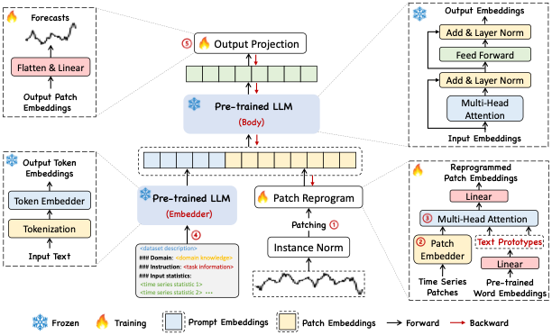

Time-LLM is a reprogramming framework to repurpose LLMs for general time
series forecasting with the backbone language models kept intact. In
other words, it transforms a forecasting task into a “language task”
that can be tackled by an off-the-shelf LLM.

**References**

- [Ming Jin, Shiyu Wang, Lintao Ma, Zhixuan Chu,
James Y. Zhang, Xiaoming Shi, Pin-Yu Chen, Yuxuan Liang, Yuan-Fang Li,
Shirui Pan, Qingsong Wen. “Time-LLM: Time Series Forecasting by
Reprogramming Large Language
Models”](https://arxiv.org/abs/2310.01728)



*Figure 1. Time-LLM Architecture.*

## 1. Time-LLM

### `TimeLLM`

```python
TimeLLM(
    h,
    input_size,
    patch_len=16,
    stride=8,
    d_ff=128,
    top_k=5,
    d_llm=768,
    d_model=32,
    n_heads=8,
    enc_in=7,
    dec_in=7,
    llm=None,
    llm_config=None,
    llm_tokenizer=None,
    llm_num_hidden_layers=32,
    llm_output_attention=True,
    llm_output_hidden_states=True,
    prompt_prefix=None,
    dropout=0.1,
    stat_exog_list=None,
    hist_exog_list=None,
    futr_exog_list=None,
    loss=MAE(),
    valid_loss=None,
    learning_rate=0.0001,
    max_steps=5,
    val_check_steps=100,
    batch_size=32,
    valid_batch_size=None,
    windows_batch_size=1024,
    inference_windows_batch_size=1024,
    start_padding_enabled=False,
    training_data_availability_threshold=0.0,
    step_size=1,
    num_lr_decays=0,
    early_stop_patience_steps=-1,
    val_monitor="ptl/val_loss",
    scaler_type="identity",
    random_seed=1,
    drop_last_loader=False,
    alias=None,
    optimizer=None,
    optimizer_kwargs=None,
    lr_scheduler=None,
    lr_scheduler_kwargs=None,
    dataloader_kwargs=None,
    **trainer_kwargs
)
```

Bases: <code>[BaseModel](#neuralforecast.common._base_model.BaseModel)</code>

TimeLLM

Time-LLM is a reprogramming framework to repurpose an off-the-shelf LLM for time series forecasting.

It trains a reprogramming layer that translates the observed series into a language task. This is fed to the LLM and an output
projection layer translates the output back to numerical predictions.

**Parameters:**

Name | Type | Description | Default
---- | ---- | ----------- | -------
`h` | <code>[int](#int)</code> | Forecast horizon. | *required*
`input_size` | <code>[int](#int)</code> | autorregresive inputs size, y=[1,2,3,4] input_size=2 -> y\_[t-2:t]=[1,2]. | *required*
`patch_len` | <code>[int](#int)</code> | length of patch. Default: 16 | <code>16</code>
`stride` | <code>[int](#int)</code> | stride of patch. Default: 8 | <code>8</code>
`d_ff` | <code>[int](#int)</code> | dimension of fcn. Default: 128 | <code>128</code>
`top_k` | <code>[int](#int)</code> | top tokens to consider. Default: 5 | <code>5</code>
`d_llm` | <code>[int](#int)</code> | hidden dimension of LLM. Default: 768 # LLama7b:4096; GPT2-small:768; BERT-base:768 | <code>768</code>
`d_model` | <code>[int](#int)</code> | dimension of model. Default: 32 | <code>32</code>
`n_heads` | <code>[int](#int)</code> | number of heads in attention layer. Default: 8 | <code>8</code>
`enc_in` | <code>[int](#int)</code> | encoder input size. Default: 7 | <code>7</code>
`dec_in` | <code>[int](#int)</code> | decoder input size. Default: 7 | <code>7</code>
`llm` | <code>[str](#str)</code> | Path to pretrained LLM model to use. If not specified, it will use GPT-2 from https://huggingface.co/openai-community/gpt2" | <code>None</code>
`llm_config` | <code>[dict](#dict)</code> | Deprecated, configuration of LLM. If not specified, it will use the configuration of GPT-2 from https://huggingface.co/openai-community/gpt2" | <code>None</code>
`llm_tokenizer` | <code>[str](#str)</code> | Deprecated, tokenizer of LLM. If not specified, it will use the GPT-2 tokenizer from https://huggingface.co/openai-community/gpt2" | <code>None</code>
`llm_num_hidden_layers` | <code>[int](#int)</code> | hidden layers in LLM. Default: 32 | <code>32</code>
`llm_output_attention` | <code>[bool](#bool)</code> | whether to output attention in encoder. Default: True | <code>True</code>
`llm_output_hidden_states` | <code>[bool](#bool)</code> | whether to output hidden states. Default: True | <code>True</code>
`prompt_prefix` | <code>[str](#str)</code> | prompt to inform the LLM about the dataset. Default: None | <code>None</code>
`dropout` | <code>[float](#float)</code> | dropout rate. Default: 0.1 | <code>0.1</code>
`stat_exog_list` | <code>[list](#list)</code> | static exogenous columns. | <code>None</code>
`hist_exog_list` | <code>[list](#list)</code> | historic exogenous columns. | <code>None</code>
`futr_exog_list` | <code>[list](#list)</code> | future exogenous columns. | <code>None</code>
`loss` | <code>PyTorch module</code> | instantiated train loss class from [losses collection](./losses.pytorch.html). | <code>[MAE](#neuralforecast.losses.pytorch.MAE)()</code>
`valid_loss` | <code>PyTorch module</code> | instantiated valid loss class from [losses collection](./losses.pytorch.html). | <code>None</code>
`learning_rate` | <code>[float](#float)</code> | Learning rate between (0, 1). Default: 1e-3 | <code>0.0001</code>
`max_steps` | <code>[int](#int)</code> | maximum number of training steps. Default: 1000 | <code>5</code>
`val_check_steps` | <code>[int](#int)</code> | Number of training steps between every validation loss check. Default: 100 | <code>100</code>
`batch_size` | <code>[int](#int)</code> | number of different series in each batch. Default: 32 | <code>32</code>
`valid_batch_size` | <code>[int](#int)</code> | number of different series in each validation and test batch, if None uses batch_size. Default: None | <code>None</code>
`windows_batch_size` | <code>[int](#int)</code> | number of windows to sample in each training batch, default uses all. Default: 1024 | <code>1024</code>
`inference_windows_batch_size` | <code>[int](#int)</code> | number of windows to sample in each inference batch. Default: 1024 | <code>1024</code>
`start_padding_enabled` | <code>[bool](#bool)</code> | if True, the model will pad the time series with zeros at the beginning, by input size. Default: False | <code>False</code>
`training_data_availability_threshold` | <code>[Union](#Union)\[[float](#float), [List](#List)\[[float](#float)\]\]</code> | minimum fraction of valid data points required for training windows. Single float applies to both insample and outsample; list of two floats specifies [insample_fraction, outsample_fraction]. Default 0.0 allows windows with only 1 valid data point (current behavior). | <code>0.0</code>
`step_size` | <code>[int](#int)</code> | step size between each window of temporal data. Default: 1 | <code>1</code>
`num_lr_decays` | <code>[int](#int)</code> | Number of learning rate decays, evenly distributed across max_steps. Default: -1 | <code>0</code>
`early_stop_patience_steps` | <code>[int](#int)</code> | Number of validation iterations before early stopping. Default: -1 | <code>-1</code>
`val_monitor` | <code>[str](#str)</code> | metric to monitor for early stopping. Valid options: "ptl/val_loss", "valid_loss", "train_loss". Default: "ptl/val_loss" | <code>'ptl/val_loss'</code>
`scaler_type` | <code>[str](#str)</code> | type of scaler for temporal inputs normalization see [temporal scalers](https://github.com/Nixtla/neuralforecast/blob/main/neuralforecast/common/_scalers.py). Default: 'identity' | <code>'identity'</code>
`random_seed` | <code>[int](#int)</code> | random_seed for pytorch initializer and numpy generators. Default: 1 | <code>1</code>
`drop_last_loader` | <code>[bool](#bool)</code> | if True `TimeSeriesDataLoader` drops last non-full batch. Default: False | <code>False</code>
`alias` | <code>[str](#str)</code> | optional, Custom name of the model. | <code>None</code>
`optimizer` | <code>Subclass of 'torch.optim.Optimizer'</code> | optional, user specified optimizer instead of the default choice (Adam). | <code>None</code>
`optimizer_kwargs` | <code>[dict](#dict)</code> | optional, list of parameters used by the user specified `optimizer`. | <code>None</code>
`lr_scheduler` | <code>Subclass of 'torch.optim.lr_scheduler.LRScheduler'</code> | optional, user specified lr_scheduler instead of the default choice (StepLR). | <code>None</code>
`lr_scheduler_kwargs` | <code>[dict](#dict)</code> | optional, list of parameters used by the user specified `lr_scheduler`. | <code>None</code>
`dataloader_kwargs` | <code>[dict](#dict)</code> | optional, list of parameters passed into the PyTorch Lightning dataloader by the `TimeSeriesDataLoader`. | <code>None</code>
`**trainer_kwargs` | <code>[int](#int)</code> | keyword trainer arguments inherited from [PyTorch Lightning's trainer](https://pytorch-lightning.readthedocs.io/en/stable/api/pytorch_lightning.trainer.trainer.Trainer.html?highlight=trainer). | <code>{}</code>

<details class="references" open markdown="1">
<summary>References</summary>

- [Ming Jin, Shiyu Wang, Lintao Ma, Zhixuan Chu, James Y. Zhang, Xiaoming Shi, Pin-Yu Chen, Yuxuan Liang, Yuan-Fang Li, Shirui Pan, Qingsong Wen. "Time-LLM: Time Series Forecasting by Reprogramming Large Language Models"](https://arxiv.org/abs/2310.01728)

</details>

#### `TimeLLM.fit`

```python
fit(
    dataset, val_size=0, test_size=0, random_seed=None, distributed_config=None
)
```

Fit.

The `fit` method, optimizes the neural network's weights using the
initialization parameters (`learning_rate`, `windows_batch_size`, ...)
and the `loss` function as defined during the initialization.
Within `fit` we use a PyTorch Lightning `Trainer` that
inherits the initialization's `self.trainer_kwargs`, to customize
its inputs, see [PL's trainer arguments](https://pytorch-lightning.readthedocs.io/en/stable/api/pytorch_lightning.trainer.trainer.Trainer.html?highlight=trainer).

The method is designed to be compatible with SKLearn-like classes
and in particular to be compatible with the StatsForecast library.

By default the `model` is not saving training checkpoints to protect
disk memory, to get them change `enable_checkpointing=True` in `__init__`.

**Parameters:**

Name | Type | Description | Default
---- | ---- | ----------- | -------
`dataset` | <code>[TimeSeriesDataset](#TimeSeriesDataset)</code> | NeuralForecast's `TimeSeriesDataset`, see [documentation](./tsdataset.html). | *required*
`val_size` | <code>[int](#int)</code> | Validation size for temporal cross-validation. | <code>0</code>
`random_seed` | <code>[int](#int)</code> | Random seed for pytorch initializer and numpy generators, overwrites model.__init__'s. | <code>None</code>
`test_size` | <code>[int](#int)</code> | Test size for temporal cross-validation. | <code>0</code>

**Returns:**

Type | Description
---- | -----------
| None

#### `TimeLLM.predict`

```python
predict(
    dataset,
    test_size=None,
    step_size=1,
    random_seed=None,
    quantiles=None,
    h=None,
    explainer_config=None,
    **data_module_kwargs
)
```

Predict.

Neural network prediction with PL's `Trainer` execution of `predict_step`.

**Parameters:**

Name | Type | Description | Default
---- | ---- | ----------- | -------
`dataset` | <code>[TimeSeriesDataset](#TimeSeriesDataset)</code> | NeuralForecast's `TimeSeriesDataset`, see [documentation](./tsdataset.html). | *required*
`test_size` | <code>[int](#int)</code> | Test size for temporal cross-validation. | <code>None</code>
`step_size` | <code>[int](#int)</code> | Step size between each window. | <code>1</code>
`random_seed` | <code>[int](#int)</code> | Random seed for pytorch initializer and numpy generators, overwrites model.__init__'s. | <code>None</code>
`quantiles` | <code>[list](#list)</code> | Target quantiles to predict. | <code>None</code>
`h` | <code>[int](#int)</code> | Prediction horizon, if None, uses the model's fitted horizon. Defaults to None. | <code>None</code>
`explainer_config` | <code>[dict](#dict)</code> | configuration for explanations. | <code>None</code>
`**data_module_kwargs` | <code>[dict](#dict)</code> | PL's TimeSeriesDataModule args, see [documentation](https://pytorch-lightning.readthedocs.io/en/1.6.1/extensions/datamodules.html#using-a-datamodule). | <code>{}</code>

**Returns:**

Type | Description
---- | -----------
| None

### Usage example

```python 
import pandas as pd
import matplotlib.pyplot as plt

from neuralforecast import NeuralForecast
from neuralforecast.models import TimeLLM
from neuralforecast.utils import AirPassengersPanel

Y_train_df = AirPassengersPanel[AirPassengersPanel.ds<AirPassengersPanel['ds'].values[-12]] # 132 train
Y_test_df = AirPassengersPanel[AirPassengersPanel.ds>=AirPassengersPanel['ds'].values[-12]].reset_index(drop=True) # 12 test

prompt_prefix = "The dataset contains data on monthly air passengers. There is a yearly seasonality"

timellm = TimeLLM(h=12,
                 input_size=36,
                 llm='openai-community/gpt2',
                 prompt_prefix=prompt_prefix,
                 batch_size=16,
                 valid_batch_size=16,
                 windows_batch_size=16)

nf = NeuralForecast(
    models=[timellm],
    freq='ME'
)

nf.fit(df=Y_train_df, val_size=12)
forecasts = nf.predict(futr_df=Y_test_df)
```

## 2. Auxiliary Functions

### `ReprogrammingLayer`

```python
ReprogrammingLayer(
    d_model, n_heads, d_keys=None, d_llm=None, attention_dropout=0.1
)
```

Bases: <code>[Module](#torch.nn.Module)</code>

ReprogrammingLayer

### `FlattenHead`

```python
FlattenHead(n_vars, nf, target_window, head_dropout=0)
```

Bases: <code>[Module](#torch.nn.Module)</code>

FlattenHead

### `PatchEmbedding`

```python
PatchEmbedding(d_model, patch_len, stride, dropout)
```

Bases: <code>[Module](#torch.nn.Module)</code>

PatchEmbedding

### `TokenEmbedding`

```python
TokenEmbedding(c_in, d_model)
```

Bases: <code>[Module](#torch.nn.Module)</code>

TokenEmbedding

### `ReplicationPad1d`

```python
ReplicationPad1d(padding)
```

Bases: <code>[Module](#torch.nn.Module)</code>

ReplicationPad1d
